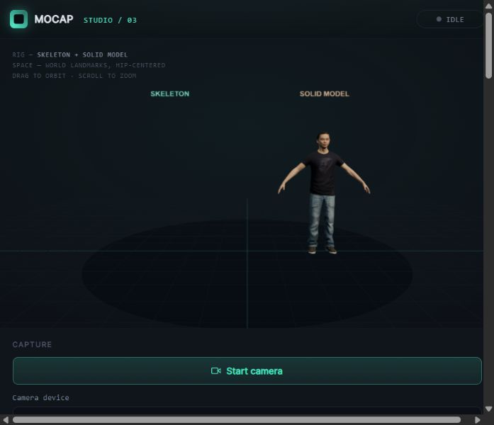

# 🕺 MOCAP Studio — Professional v3.1

**A local-first, browser-based motion capture studio with a ready-to-use realistic male avatar.**

Capture up to **553 landmarks** (33 body, 42 hands, 478 face), **52 facial coefficient channels** and a head-pose matrix. Track one person from a webcam, analyze a local photo, inspect a textured humanoid, record movement, and replay or export sessions. No backend, paid service, API key, bundler, or npm installation is required to run the dashboard.

> 📌 **Version 3.1.0 · October 26, 2026** — Based on the supplied MOCAP Professional v2 source. All application code, interface labels, comments, and documentation are English.



[View the facial rig close-up](docs/face-detail-preview.png)

## 🚀 Start in one minute

1. Extract the **entire** project folder.
2. On Windows, double-click **`start-dashboard.bat`** with Python 3 installed.
3. The launcher opens **http://localhost:8000/**.
4. The bundled Studio Male appears automatically. Use **Face close-up** or orbit the view to inspect the rig.
5. Choose **Start camera** and allow camera access when you want live capture.

Or use a terminal:

```bash
python scripts/serve.py
```

If the port is busy:

```bash
python scripts/serve.py --port 8001
```

A standard static server also works:

```bash
python -m http.server 8000 --bind 127.0.0.1
```

**Use localhost or HTTPS.** Browsers do not allow normal camera capture from a double-clicked `file://` page. Keep the server window open while working. Chrome and Edge are the primary desktop targets; other browsers may select the fallback engine.

## ✨ What v3 improves

| Area | v2 | v3 |
|---|---|---|
| Inference scheduling | Synchronous work on the interface thread | Dedicated classic Web Worker, transferable ImageBitmap frames, one in-flight inference, explicit timeouts and fallback |
| Startup | Tracking model blocks entry into the dashboard | Immediate viewport and character; tracking runtime loads on demand |
| Network dependencies | Remote runtime, remote tracking model and remote Xbot | Local Three.js, MediaPipe, WASM, tracking model and character; integrity manifest included |
| Motion filtering | Fixed exponential smoothing | Speed-adaptive One Euro vector filter, confidence-gated body updates, no additional limb quaternion smoothing |
| Human character | External Xbot | Local textured Studio Male wearing a T-shirt, denim jeans and sneakers |
| Rig mapping | Alias matching | Explicit semantic metadata for the supplied character, plus retained Mixamo/VRM/alias support |
| Retargeting | Pelvis and limb directions | Pelvis/torso, matrix-based head rotation, both palm frames, all 30 finger segments and 51 facial expression morphs; corrected mirror-side mapping |
| Capture controls | Default webcam | Camera selection, four quality presets, specialized Precision or integrated Efficient pipeline, camera-disconnect handling |
| Input sources | Webcam | Webcam and local photo |
| Recording | Latest pose snapshot | Bounded multi-frame recording, JSON session export/import, world-landmark CSV |
| Playback | None | Timeline scrubbing, pause/play, 0.5× / 1× / 2× speed |
| Diagnostics | FPS and last inference | Elapsed-time FPS, median/p95 pipeline latency, component timings, capture guidance and diagnostic JSON |
| Delivery | Source and generated HTML | Source, generated HTML with embedded character/worker, local runtime files, launcher, tests and provenance |

These are engineering improvements, **not a claim that every camera or device becomes faster or more accurate**. The ML model and its inherent monocular limitations remain. See [Validation](docs/VALIDATION.md).

## 🛠️ What changed in 3.1

- Removed the demo button, generated-motion source and runtime branch from both dashboard builds.
- Added cancellable, bounded camera startup, late-stream cleanup, actual camera information and clearer Windows privacy/disconnect errors.
- Serialized model-option changes with inference and reset stale joint filters after occlusion. Fingers now filter relative hand offsets separately from wrist movement.
- Gated pelvis/head updates on visible anchors and averaged the neutral head reference across all 30 calibration samples.
- Reduced idle GPU work by rendering when the scene changes. Added elapsed-time FPS, component timings, median/p95 pipeline latency and **Export live diagnostics**.
- Added optional **Pose-guided hand detail**: enlarges two reliable separated hand regions in one inference image; falls back to the full frame when crops overlap. It uses image detection and can cost more. The default uses temporal full-frame hand tracking for responsiveness. Compare both modes in your own framing.
- Added versioned local module URLs and server revalidation to avoid mixing cached older code with an updated interface.

Physical-camera observations and limitations are documented in [the webcam report](docs/WEBCAM_TEST.md). No geometric ground-truth accuracy percentage is claimed.

## 🧍 Included character — Studio Male

The dashboard loads **`assets/models/studio-male.glb`** automatically. To use it in another compatible viewer or re-import it, choose **Upload 3D model** and select that file.

| Property | Delivered asset |
|---|---|
| Appearance | Adult male; dark short-sleeve T-shirt; denim jeans; casual sneakers |
| Format | Self-contained GLB 2.0 with embedded textures |
| Download size | **895,084 bytes / 0.85 MiB** |
| Geometry | **7,428 triangles** |
| Skeleton | **80 skin joints**, 52 named semantic roles, 12/12 mapped limb direction pairs, 30/30 finger segments and 2/2 palm frames |
| Facial rig | **51 sparse expression morphs**, driven by 52 MediaPipe coefficient channels including neutral |
| Textures | Four **1024×1024** color/normal maps plus one **1024×512** opacity/color map |
| Materials | Embedded color and normal textures; nonmetallic rough surfaces; alpha-masked details |
| Compression | Meshopt geometry, WebP textures and quantized mesh attributes |
| License | **MIT** — Microsoft / Rocketbox attribution and license are included |

This is an **adapted realistic real-time character**, not a newly sculpted person or a new photogrammetry scan. Its photographic-style texture detail is balanced against a small mesh and compact download. It is suitable for an interactive dashboard rather than cinematic close-ups. The original textured geometry comes from Microsoft Rocketbox, distributed as an optimized GLB by CodeLove. This project standardizes bone names, adds a deterministic humanoid map, authors 51 sparse facial morphs from the existing facial skin/bone weights and integrates body, palm, finger and facial retargeting. The expression shapes are an authored approximation rather than a measured FACS scan.

See [asset provenance](assets/models/PROVENANCE.md) and [the asset manifest](assets/models/studio-male.json). The rebuild adapter `scripts/prepare_character.py` verifies the upstream input checksum before modifying it.

## 🎭 Face, gaze, head and fingers

The supplied model supports **all three segments of all ten fingers** and a two-axis palm frame for each wrist, rather than rotating the hand from only one wrist-to-finger direction. Detected wrist positions associate hands with the selected body when available; independent hand detections can still animate fingers while body tracking is absent, with the avatar wrists held at their current/rest anchors.

The face pipeline captures **478 points**, the full **52-channel MediaPipe coefficient vector** (neutral plus 51 expression channels), and a raw **4×4 face transformation matrix** in Precision mode. The rig uses head rotation plus blink, gaze direction, jaw, lips, smile/frown, cheeks, brows and nose expression shapes. A custom model needs matching morph targets and recognized finger bones to display the same coverage; the diagnostic panel reports actual mapped controls.

- **Face animation** enables expression/head animation. **Dense face overlay** shows the face points in the source preview.
- **Calibrate neutral:** look forward with a relaxed face. During capture the app averages 30 detected face samples (a stopped/photo view uses one explicitly selected still reference), then subtracts baseline expression bias and uses the neutral head rotation as an offset. This is an optional neutral-reference adjustment, not a ground-truth accuracy calibration.
- **Reset neutral** removes that reference.
- **Face close-up / Full body view** help inspect the character.
- Body, hand/finger and face smoothing are separate. Blinks bypass coefficient smoothing to retain short closures.
- Full face, hand and body data is retained in session JSON. **Export full-detail CSV** includes each landmark stream, expression coefficient and head-matrix element. **Body CSV** remains a compact body-world-only export.

A wide full-body shot makes the face and fingertips small in the camera image. Moving closer improves their visible detail but may cut off the feet. No software can recover the same ground-truth detail as dedicated close cameras, an eye tracker or a multi-camera mocap stage from every single webcam view. Tongue motion, individual toe articulation, accurate contact forces and occluded finger joints are not measured by these models.

## 🎮 Capture and processing

- **Start camera:** requests a video-only stream first, shows the preview, then initializes the local tracker. **Cancel camera startup** remains available during permission/model loading. Permission requests time out after 45 seconds; late streams are stopped. Windows system privacy denial has a specific error message. Audio is never requested.
- **Preload tracking engine:** initializes inference without opening a camera. The engine readout shows Worker/Main thread and GPU/CPU.
- **Analyze a local photo:** selects a JPEG, PNG or WebP file, processes one frame locally and enables pose export. Limit: 15 MiB and 32 megapixels. It does not upload the photo.
- **Camera device:** select an available camera before starting. Device labels may appear only after browser permission has been granted.
- **Fullscreen:** expands the 3D viewport. Escape exits fullscreen using normal browser behavior.

| Preset | Requested camera size | Maximum worker frame width | Target inference rate | Render pixel ratio cap |
|---|---:|---:|---:|---:|
| Performance | 640×480 | 640 | 20 fps | 1.0 |
| Balanced | 960×540 | 960 | 30 fps | 1.5 |
| Quality | 1280×720 | 1280 | 30 fps | 2.0 |
| Maximum detail (default) | 1920×1080 | 1920 | 15 fps | 2.0 |

Targets are ceilings, not guaranteed achieved frame rates. Maximum detail requests a 30 fps camera stream and samples at up to 15 fps; select Quality if temporal detail matters more and your hardware can sustain the specialized pipeline. Camera constraints are best-effort; the source aspect ratio is preserved when frames are resized. Main-thread fallback uses the camera's supported source resolution. The 3D viewport renders on scene/control changes; idle views avoid continuous GPU draws. Hidden pages skip inference and rendering; a completed in-flight frame may still return. Hands are inferred even when **Hand visualization** is disabled; that switch controls visualization/retargeting, not model compute.

For best results, use even lighting, a stable camera and enough distance to show the entire body. Avoid occluded wrists, feet outside the frame and very fast motion blur. Confidence controls gate the task, while adaptive smoothing balances jitter and responsiveness.

The default **Precision** pipeline uses separate **Pose Landmarker Heavy**, **Face Landmarker** and **Hand Landmarker** tasks on the same image/timestamp. It prioritizes the strongest included body model and dedicated face/hand outputs. **Efficient** retains the integrated Holistic task. Both run in a bounded worker when supported. Precision needs more compute and model memory; it does not guarantee a higher measured accuracy in every scene.

Precision model files total approximately **40.3 MiB**, loaded only when the engine starts. The lightweight character and UI do not wait for those models. The full distribution also contains the Efficient model and runtime binaries for offline use.

**Export live diagnostics** saves a rolling window of up to 120 result timings, detected face/both-hand availability, visible feet, actual camera settings and component median/p95 values. It contains no camera images, video, landmarks or device IDs. Availability is the fraction of results with detections, not a position-accuracy score. FPS uses elapsed time between delivered results; pipeline latency includes snapshot/worker transfer but excludes camera sensor/display latency.

## ⏺️ Record, export and replay

1. Start live capture.
2. Click **Record session**, then **Stop recording**.
3. Save **JSON** for replay, or export **CSV** for analysis.
4. Stop the source and click **Play**. Use the timeline or playback speed control.
5. Reopen a saved session with **Open session**.

Recording stops automatically at **3,600 frames or 32 MiB of serialized frame data**, whichever comes first. Dense facial recordings usually reach the byte budget earlier than body-only recordings. At 30 fps this is approximately two minutes; actual duration follows the achieved frame rate. Starting a new recording replaces the in-memory recording. Export before recording another take or closing the tab. Sessions are not automatically persisted.

Session JSON contains raw/unmirrored MediaPipe body/hand image and world landmarks, dense normalized face landmarks, all facial coefficients, the head transformation matrix when available, timestamps and inference timings. It also saves the current neutral-reference and capture settings. Body/hand world coordinates are in meters; face landmark depth is normalized relative depth, not calibrated absolute world geometry. The face matrix is preserved in MediaPipe format; avatar root translation is not driven from that matrix. Missing per-point visibility is recorded as null/blank rather than invented confidence. Coordinates are rounded to six decimal places to reduce output size; this is far below ordinary webcam measurement precision. JSON uses a compact format. Import accepts up to **40 MiB**, validates timestamps and landmark shapes, and rejects malformed data. CSV includes world pose landmarks only (`time_ms,landmark,x_m,y_m,z_m,visibility`). An empty world-landmark result contributes no CSV rows.

**Export frame JSON** exports the latest available body, face and hand result, including face-only captures. Captured coordinates are independent of the display mirror switch. Replay uses the current display and filter settings; scrub previews show the selected raw sample without blending with a future sample. Exports are landmarks, **not BVH/FBX animations** or calibrated skeleton rotations.

## 🦴 Custom rigs

Use **rigged GLB**, a **self-contained GLTF**, or a compatible **VRM**. The uploader reads GLB/VRM as binary and GLTF as JSON, rejects external texture/buffer URLs, validates the GLB header and enforces a 120 MiB file / 10,000-node budget. Models must contain bones and at least four usable limb direction pairs.

The bundled character has an explicit map. Other rigs use VRM metadata, Mixamo names or conservative aliases. Automatic retargeting is approximate and varies by bind pose and hierarchy. VRM facing metadata is supported, but the application does not implement the complete VRM expression, spring-bone or MToon feature set. Finger animation uses all three segments of recognized semantic finger bones and a palm frame. Precision mode uses the dedicated facial transformation matrix for head rotation; Efficient mode estimates head orientation from the available face landmarks. Facial coefficient capture remains available even if an uploaded character lacks matching expression morphs.

The viewer auto-fits model scale and puts the rest pose on the floor. It does not implement contact-constrained foot IK, physics, multi-camera triangulation, root translation recovery, multiple-person tracking or medical-grade measurements. Facial shapes and gaze are approximate real-time retargeting, not a calibrated eye tracker or a measured anatomical face reconstruction.

## 🔒 Local operation and privacy

All required application runtime files, WASM binaries, inference model files and the character are included. The app can run without internet once the folder is available; there are no CDN fonts or required external runtime fetches. The browser still requires localhost/HTTPS for camera access.

There is no application backend or video upload endpoint. Camera/photo data, landmarks and recordings are processed in the browser. MediaPipe's own privacy notice describes possible library performance/utilization telemetry; bundling the library is not a promise to disable library telemetry. Review Google's notice for deployments with additional privacy requirements.

The official tracking-model download returned a regional HTTP 403 in the build environment. The included model was obtained from a pinned public mirror and its SHA-256 is recorded in `vendor/manifest.json`. The mirror URL, original Google model URL and license are preserved for auditing.

## 📁 Project layout

```text
mocap-professional-v3/
├── index.html
├── mocap-dashboard.html
├── start-dashboard.bat
├── src/
│   ├── app.js                   # UI, capture, scene, retargeting and playback
│   ├── bootstrap.js             # Startup error reporting
│   ├── core.js                  # Adaptive filter and session data utilities
│   ├── engine.js                # Worker bridge and fallback lifecycle
│   ├── tracking-worker.js       # Background MediaPipe inference
│   └── vision-pipeline.js       # Dedicated Heavy pose/face/hands or Efficient Holistic
├── assets/
│   ├── styles.css
│   ├── models/                  # Studio Male GLB, manifest, provenance and MIT license
│   └── tracking/                # Local Holistic .task model
├── vendor/                      # Pinned Three.js, MediaPipe, WASM, licenses and hashes
├── tests/                       # Node built-in test runner; no npm dependencies
├── scripts/                     # Launcher server, validation, build and filter benchmark
├── docs/                        # Validation report and benchmark results
├── dist/mocap-dashboard.single.html
├── THIRD_PARTY_NOTICES.md
├── CHANGELOG.md
├── README.md
└── LICENSE
```

The generated HTML embeds application JavaScript/CSS, the worker source and the character. It uses **`../vendor/` and `../assets/tracking/`** from this project. Keep the project layout when using it; the generated HTML alone is not an entirely standalone/offline package.

The optional facial asset authoring tool is `scripts/build_face_morphs.mjs`. To regenerate the character, run `prepare_character.py` first, make Three.js **0.186.1** available to Node.js (only for this optional authoring step), then run the morph builder. Application use never requires npm or that authoring tool.

## 🧪 Verify and rebuild

Python 3 is required for the scripts; Node.js is required only for tests and optional JavaScript parser checks.

```bash
python scripts/validate.py
python scripts/validate_asset.py
node --test tests/core.test.js tests/engine.test.js tests/detail.test.js
node scripts/benchmark_filter.js
python scripts/build_single_file.py
```

There is no `npm install` step. `package.json` only identifies the ES module project and provides an optional test command.

The deterministic filter benchmark uses the same smoothing value and 30 Hz input for v2/v3. In that synthetic scenario, v3 reduced stationary RMS jitter from **2.29 mm to 1.81 mm** and reached 90% of a 1 m step in **100 ms instead of 300 ms**. These are filter-only results, not a live-camera accuracy score, end-to-end latency measurement or a universal speedup claim. Full values and scope are in [the benchmark file](docs/filter-benchmark.json).

## 🛠️ Troubleshooting

| Symptom | Action |
|---|---|
| Camera is unavailable | Use localhost/HTTPS and verify browser camera permission. |
| Camera is busy or disconnected | Close other camera applications, reconnect the device and restart capture. |
| Engine initialization fails | Keep the complete `vendor` and `assets/tracking` folders; check the console and local server logs. Try another current Chrome/Edge installation. |
| Worker/GPU is unavailable | The application tries main-thread and CPU fallbacks. The engine readout shows the selected path. |
| Slow processing | Choose Performance, close competing GPU workloads and reduce display load. Cold initialization is slower than warmed inference. |
| Avatar remains in rest pose | Wait for visible shoulders/hips/knees, inspect the signal bars and ensure the selected rig maps enough roles. |
| Custom GLTF requests external files | Export one self-contained GLB instead. |
| UI shows a graphics-context error | Reload the page to recreate the renderer and its resources. |
| Port 8000 is busy | Run `python scripts/serve.py --port 8001`. |

## 📜 Licenses and references

Application changes retain the supplied project's MIT license. Microsoft Rocketbox/Studio Male and Three.js are MIT; MediaPipe and its tracking model are Apache-2.0. Preserve the bundled third-party notices and license texts when redistributing.

- [Microsoft Rocketbox](https://github.com/microsoft/Microsoft-Rocketbox)
- [CodeLove model catalog and licensing](https://models.codelove.in/developers/)
- [MediaPipe Pose Landmarker](https://developers.google.com/edge/mediapipe/solutions/vision/pose_landmarker)
- [MediaPipe Face Landmarker](https://developers.google.com/edge/mediapipe/solutions/vision/face_landmarker)
- [MediaPipe HolisticLandmarker API](https://developers.google.com/edge/api/mediapipe/js/tasks-vision.holisticlandmarker)
- [MediaPipe privacy notice](https://goo.gle/mediapipe-privacy)
- [Three.js](https://github.com/mrdoob/three.js)

Built for transparent, inspectable, local motion-capture workflows. 🧍🎥🦴
